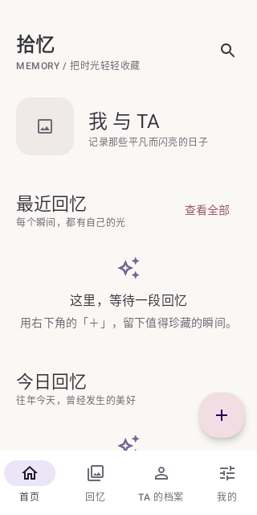
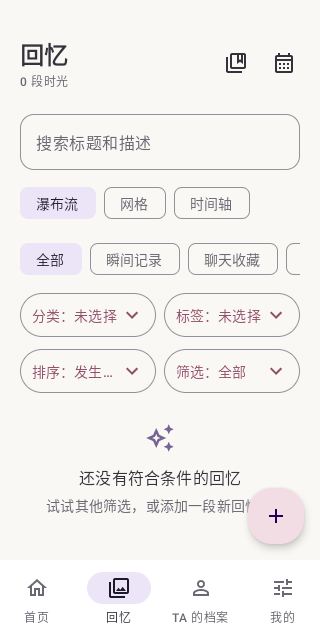
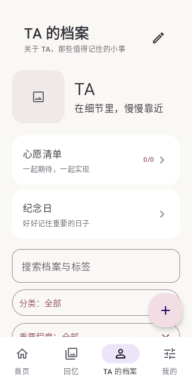
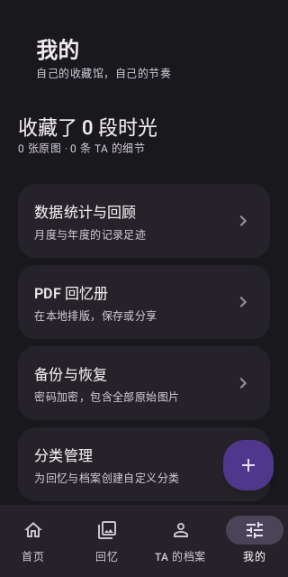

# 拾忆 · Memory

一个原生 Android 私人回忆收藏馆。把照片、聊天截图、日常瞬间，以及关于 TA 的细节，认真保存在自己的手机里。

Android 8.0（API 26）及以上；单一恋人档案。**完全离线，无账号、服务器、AI、OCR、广告、分析 SDK、会员或云同步。**

## 功能

- **首页**：双方昵称、头像、相识天数、最近回忆、往年今日、随机回忆、TA 的最近记录、未来 90 天纪念日、快捷添加。
- **回忆**：瞬间 / 聊天 / 事件 / 文字四种类型；增删改查、多张原图、调整顺序、封面、日期与可选时间、地点、心情、分类、关键词、标签、收藏与置顶。
- **聊天收藏**：手动填写摘录、背景、理由与感受；截图仅作为原始图片保存，不识别文字。
- **浏览**：瀑布流、网格、按年月分组的时间轴；日期 / 添加时间排序；类型、分类、标签、收藏与置顶筛选；多图全屏滑动、缩放和系统图片分享。
- **TA 的档案**：六大预设分类、自定义分类、重要程度、置顶、搜索及与回忆的双向关联。删除关联不删除原记录。
- **心愿**：六类愿望、图片、计划日期、备注、三种状态、关联已实现的回忆。
- **合集与日历**：合集引用已有回忆；月视图标记回忆和纪念日，切换年月、回到今天、查阅所选日期。
- **纪念日**：每年重复或一次性、提前提醒天数、备注与回忆关联。本地非精确闹钟，重启 / 日期 / 时区变化后重新调度。
- **中文全局搜索**：子字符串匹配手动文字、聊天摘录、档案、心愿与标签；模块、分类、日期范围筛选。
- **统计**：全部、月度、年度的回忆 / 照片 / 各类型 / 档案 / 心愿数量、实现数量、分类分布与每月记录数。添加统计按创建时间；实现统计按实现时间。
- **PDF 回忆册**：全部、年月、日期范围或指定合集；自定义标题、封面、图片、文字和日期地点选项；本地生成、多页排版、长截图按页宽分段、中文与比例保持，通过系统文件选择器保存。
- **完整加密备份与恢复**：结构化 JSON、全部原图、关联和设置；PBKDF2 + 分块 AES-256-GCM；先校验并展示数量，再确认覆盖；事务恢复。详见 [备份格式](docs/BACKUP_FORMAT.md)。
- **隐私设置**：浅色 / 深色 / 系统主题，数字密码应用锁、生物识别、后台立即锁定、主动开启通知、图片清理与删除全部本地数据。

所有首次安装页面为空，不预装虚构回忆或个人资料。各模块的新增入口、空状态、表单校验、保存反馈和删除确认均由真实数据驱动。

## 界面

奶油白背景，柔和粉与雾紫点缀，系统中文字体和统一圆角。四个主页面：首页 / 回忆 / TA 的档案 / 我的。右下角「＋」提供全局添加。

以下为真实 API 30 模拟器的空数据界面：

| 首页 | 回忆 | TA 的档案 | 深色模式 |
|---|---|---|---|
|  |  |  |  |

实际测试结果见 [验证记录](docs/TESTING.md)。应用默认启用 Android 安全窗口，防止系统截屏和任务缩略图泄露；测试截图仅在测试代码中针对空数据临时关闭保护。

## 技术架构

Kotlin 2.1.20、Jetpack Compose / Material 3、MVVM + Repository、Room 2.7.1 / SQLite、DataStore、Coil、Navigation Compose、Coroutines / Flow、AlarmManager、Android PdfDocument、AndroidX Photo Picker。

```text
app/src/main/java/com/shiyi/memory/
├── data/       Room 实体、DAO、迁移、Repository、DataStore
├── domain/     日期、中文检索、统计、备份结构校验、加密
├── platform/   原生 PDF、备份恢复、系统闹钟与通知
└── ui/         Compose 页面与 ViewModel
```

[数据库设计与一致性](docs/DATABASE.md) · [备份格式](docs/BACKUP_FORMAT.md) · [验证记录](docs/TESTING.md)

## 安装 APK

从本仓库的 GitHub Releases 获取附件（仅在发布成功后才会出现），或下载 GitHub Actions 的 `ShiYi-debug-APK-and-reports` 产物。也可按下节自行构建。

允许系统安装所选文件来源的应用，然后打开 APK。包名 `com.shiyi.memory`，最低 API 26。发布的 `app-debug.apk` 使用 **Gradle 默认 debug 签名**，不是正式发行签名。不要卸载后再尝试更新以解决签名冲突，卸载会丢失本地数据；请先导出加密备份。没有在仓库中保存签名私钥。

## Android Studio / 命令行构建

1. 安装支持 AGP 8.9 的 Android Studio，选择完整 JDK 17 或 21（需要 `javac`）。
2. 安装 Android SDK Platform 35、Build Tools 35.0.0 和 Platform Tools。
3. 打开本仓库，配置 SDK（Studio 生成的 `local.properties` 不提交）。
4. 执行：

```bash
./gradlew clean testDebugUnitTest lint assembleDebug
```

Gradle Wrapper 固定为 8.13，并验证发行文件的 SHA-256。Maven 依赖来自 Google 和 Maven Central，不关闭 TLS 或校验。首次构建需下载开发依赖；**安装后的应用运行无需网络**。

产物：`app/build/outputs/apk/debug/app-debug.apk`。

连接设备 / 启动模拟器后：

```bash
adb install -r app/build/outputs/apk/debug/app-debug.apk
adb shell am start -n com.shiyi.memory/.MainActivity
./gradlew connectedDebugAndroidTest
```

云环境可执行 `bash scripts/cloud-setup.sh`；它在 `/workspace/tooling` 准备经校验的 JDK 与 Android SDK，并执行测试、Lint 和构建。此脚本专用于本云环境目录，不适用于直接覆盖本机 JDK 配置。普通开发请使用上面的 Android Studio 流程。

## 使用和数据安全

首次进入 TA 的档案，设置昵称、头像及可选相识日期；随后从「＋」添加回忆和档案细节。所有图片从系统选择器选择，复制到应用私有目录，保留原始字节、原始质量与元数据，不申请整个相册的权限。原相册文件不会因应用内删除而删除。

在「我的 → 备份与恢复」设置独立备份密码，选择本地文件位置导出 `.shiyi`。备份包含图片，不只是数据库。恢复时选择备份、输入原密码、等待完整性验证、核对数量，再确认覆盖。恢复保留当前设备的应用锁和通知授权，以免改变本机安全配置。不要在没有验证备份可读的情况下删除原数据。

应用锁的密码使用独立随机盐和 PBKDF2 哈希，不存明文；支持设备已录入的系统生物识别。**应用锁不等于数据库或媒体加密**：内部数据依靠 Android 私有沙盒保护，无法对已获取系统权限的攻击作保证。导出备份始终加密；备份密码无法找回，请使用强密码并自行妥善保存。

应用没有 INTERNET 权限，关闭 Android 自动云备份和设备迁移，不上传数据。系统文件选择器可能提供你安装的云盘；选择那个位置属于用户自己的显式导出行为，应用不会自动同步。

通知仅在主动开启时申请 Android 13+ 权限；内容是通用提示，不显示私人聊天或纪念日名称。不申请精确闹钟特殊权限。荣耀设备的电池管理可能延迟提醒，必要时在系统设置允许后台运行。通知并非医疗或安全关键提醒工具。

卸载应用会删除私有数据。彻底删除功能会清除应用内部记录、媒体与缓存，已导出的外部备份需自行删除。闪存不能保证物理取证级擦除。

## 开源协议

[MIT](LICENSE)。不提交个人照片、聊天、数据库、备份密码、访问令牌或签名密钥。自动化测试仅使用生成图片与合成文字。
