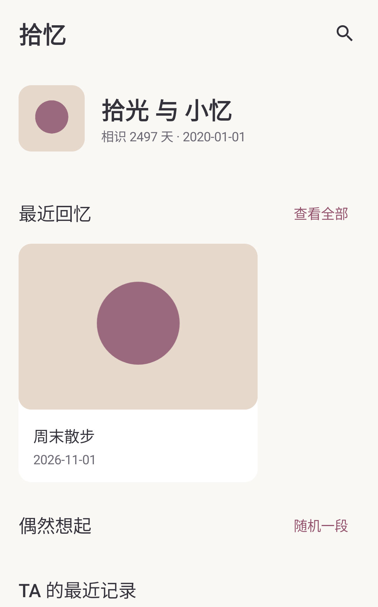
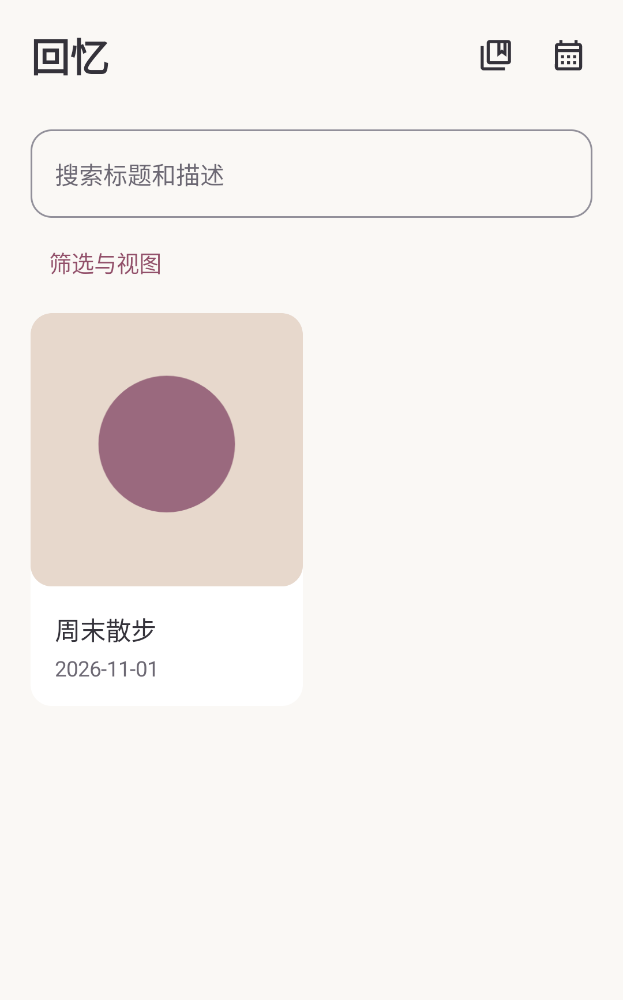
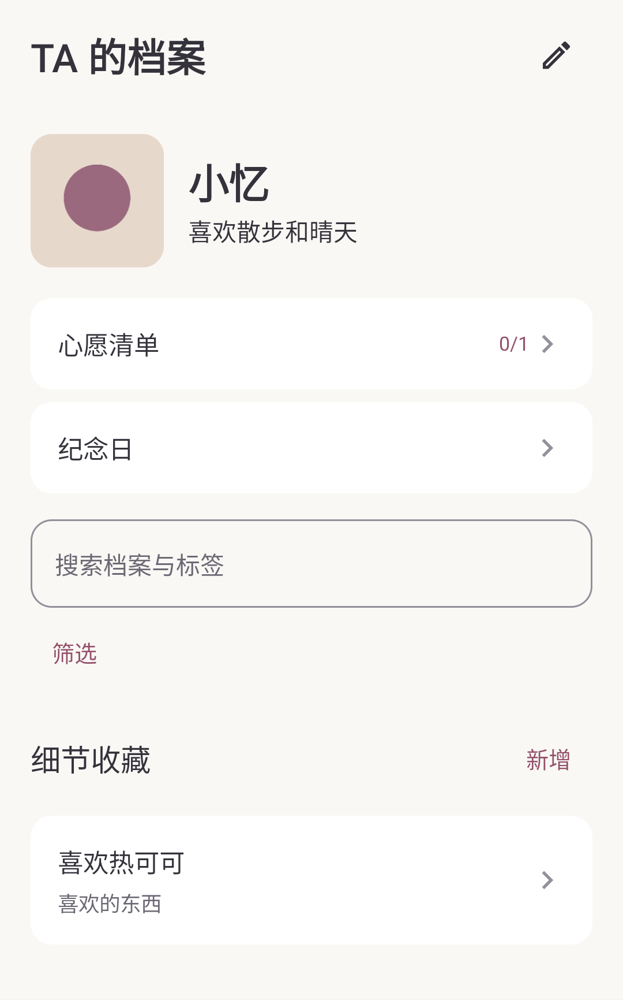
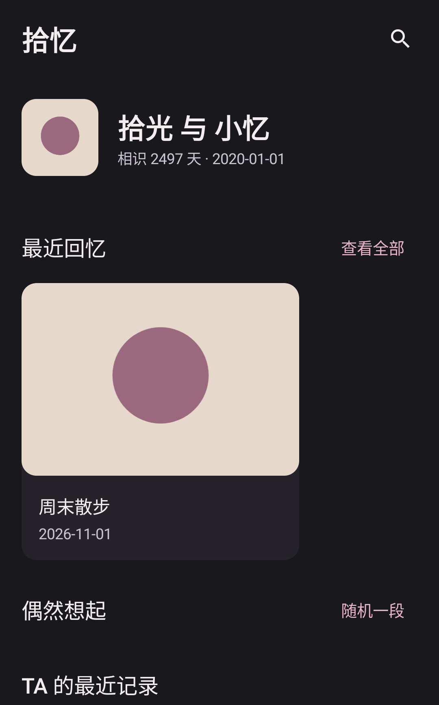

# 拾忆 ShiYi

完全离线的 Android 私人回忆收藏馆。保存照片、聊天截图和手写记录，整理关于 TA 的细节、纪念日与心愿。

**1.1.0 开发候选** · Android 8.0+（API 26）· `com.shiyi.memory` · MIT

> 开发与主要自动化验收已完成。正式发布尝试在签名预检停止：工作流读取不到 `ANDROID_KEYSTORE_BASE64`。尚无 v1.1.0 稳定 Release；请按 [签名配置步骤](docs/RELEASE.md) 完成长久密钥和 Secrets 配置。实际范围见 [验证记录](docs/TESTING.md)。

[GitHub Releases](https://github.com/J-Ruan/ShiYi/releases) · [签名与发布配置](docs/RELEASE.md) · [更新记录](CHANGELOG.md)

## 功能

- 快速记录：原图、标题、日期和可选描述；其他字段放在“更多细节”，保存后可继续记录。
- Android 分享：接收单张或多张图片，校验后复制到私有存储；重复 URI 去重，完成导入的分享草稿可在进程重启后继续。
- 回忆：瞬间、聊天、事件和文字；多图顺序与封面、收藏、置顶、标签、分类、相关档案及回忆。聊天仅手动摘录，无 OCR。
- 回收站：删除后保留 30 天、短时撤销、恢复、永久删除与清空；共用图片不会被提前删除。
- 浏览：时间轴 / 网格 / 瀑布流；日期、标签、类型、收藏、分类筛选；发生时间、最近添加和最早添加排序。日历跨月保持合理选中日期。
- TA 的档案：头像、昵称、相识日、六大细节分类、重要程度和双向回忆关联；心愿、纪念日、合集及自定义分类。
- 中文搜索、月度 / 年度统计与回顾；PDF 封面、目录、月份分隔页、中文长文换页、长截图分区和原比例图片。
- 存储管理：图片数量、分类空间、最近备份、未引用文件与可释放空间；确认前预览，清理时重新检查引用。
- 加密备份：全部记录、回收站、原始图片及关系；密码验证、完整性校验、恢复预览与事务回滚；兼容 1.0.0 备份。

不预装虚构个人资料。应用没有 INTERNET 或广泛相册权限，无账号、服务器、云同步、广告、追踪、AI 或 OCR。

## 设计

保留奶油白、柔和粉与雾紫。统一 26sp 页面标题、20sp 模块标题、17sp 卡片标题及 14–16sp 正文；移除解释性副标题，卡片突出图片、标题和日期，高级筛选与字段按需展开。支持浅色 / 深色 / 跟随系统。

以下为 API 30 自动化生成的合成数据页面，已逐页检查；[完整 18 页截图及检查](docs/screenshots/1.1.0/README.md)。

| 首页 | 回忆 | TA 的档案 | 深色模式 |
|---|---|---|---|
|  |  |  |  |

[45 项 JVM / 20 项设备测试的成功 CI](https://github.com/J-Ruan/ShiYi/actions/runs/41278695985) · [验证范围与未执行项目](docs/TESTING.md)。旧版截图不作为本轮证据。

## 数据与隐私

1.1.0 使用 SQLCipher 加密本地数据库，AES-256-GCM 分块加密图片，随机密钥由 Android Keystore 保护，与应用锁 PIN 独立。图片保留原始编码字节与质量，不主动压缩。应用锁支持 PIN / 生物识别，安全窗口保护系统截图和任务缩略图；通知只显示通用提醒。

旧数据先复制迁移，验证记录、外键与原图 SHA-256 后才清理旧明文。失败会保留原数据并显示恢复入口，不能用清空数据库解决迁移。设备已被攻破、密钥丢失或卸载时，本地加密不能代替可靠备份。

在“我的 → 备份与恢复”设置独立备份密码，导出 `.shiyi` 并另存到可信位置。恢复前先完整校验和核对数量；恢复覆盖记录，只迁移主题，不覆盖本机 PIN、生物识别、通知或备份位置。新手机通过备份密码解密，再用自己的本地密钥加密。密码无法找回。

图片解码、分享和 PDF 使用受控私有临时明文，操作后清理。主动分享的临时文件最多保留 10 分钟，供接收应用读取。Android 自动云备份与设备迁移已禁用。系统文件选择器中用户主动选择的云盘由该提供方处理，拾忆不会自动上传。

[数据库与迁移](docs/DATABASE.md) · [备份格式](docs/BACKUP_FORMAT.md) · [安全说明](SECURITY.md)

## 安装与升级

当前可直接下载：[1.1.0 可安装测试 APK（Debug 签名，38.89 MiB）](https://github.com/J-Ruan/ShiYi/raw/refs/heads/main/downloads/ShiYi-1.1.0-debug.apk?download=1) · [SHA-256 校验文件](downloads/SHA256SUMS)。

此测试包与旧 1.0.0 APK 的证书不同，不能直接覆盖安装。**先导出并验证加密备份，再卸载旧版、安装并恢复。**

正式版通过 [GitHub Release 附件](https://github.com/J-Ruan/ShiYi/releases) 分发，预期文件名 `ShiYi-1.1.0-release.apk`，并提供 `SHA256SUMS.txt`。当前正式签名尚未配置，不将测试包标记为正式稳定版。

`downloads/` 中提供 Debug 测试包。因 Release 附件上传认证失败，本次按下载需求通过仓库文件提供 1.1.0 测试 APK；正式 APK 继续使用 Release 附件分发。

从 Debug 转正式版：

1. 在旧版导出加密备份，输入原密码验证备份可读，复制到可信位置。
2. 确认备份完整后卸载旧 Debug 版；卸载会删除应用内部数据。
3. 下载并核对正式版校验值，安装正式签名 APK。
4. 恢复 `.shiyi`，重新设置本机应用锁与通知。

Debug 和正式证书不同，不能直接覆盖安装。已经安装正式版的后续升级必须继续使用原发行密钥。

## 构建与测试

Kotlin 2.1.20、Compose BOM 2025.04.01 / Material 3、Room 2.7.1、SQLCipher Android 4.10.0、DataStore、Coil、Coroutines / Flow。AGP 8.9.3，Gradle 8.13，compile / target SDK 35，JDK 21。

```bash
./gradlew clean testDebugUnitTest lint assembleDebug assembleRelease
```

配置 [正式签名环境变量](docs/RELEASE.md) 后产出 `app/build/outputs/apk/release/app-release.apk`；没有签名时产出 `app-release-unsigned.apk`，只能用于工程检查，不能作为正式安装包。Debug 产物在 `app/build/outputs/apk/debug/app-debug.apk`。

设备测试**只在全新模拟器或专用空安装运行**：

```bash
./gradlew connectedDebugAndroidTest
```

检测到已有资料、媒体或个人设置时测试会拒绝运行，不得移除保护。JVM 使用隔离 fixture，真实 SQLCipher、Keystore、迁移、原图和 PDF 由设备测试验证。云环境可用 `bash scripts/cloud-setup.sh` 准备工具与构建。CI 不安装废弃 SDK `tools` 包。

## 常见问题

- **忘记 PIN？** PIN 与数据密钥不同；不要直接卸载或清除数据。备份密码不能找回，请妥善保存。
- **迁移失败？** 旧文件会保留；检查可用空间后在错误页重试，不清除数据。
- **设置损坏？** 错误页可重试或明确确认恢复默认设置，不清空回忆数据库。
- **提醒晚到？** 本地非精确闹钟受系统省电与后台管理影响，可在设备设置允许后台运行。
- **清理会删掉回收站或共用图片吗？** 不会；清理重新核对全部引用，并保护分享草稿与最近导入图片。
- **换手机？** 使用加密备份；不要复制旧手机 Keystore 文件。

## English

ShiYi is a fully offline Android memory journal for original photos, manually saved conversations, personal details, anniversaries, wishes and collections. Version 1.1.0 introduces a quieter Compose interface, quick capture, Android sharing, a 30-day recycle bin, reviewed storage cleanup, SQLCipher and authenticated image encryption. No account, server, Internet permission, AI, OCR, ads or tracking. Android 8.0+. Signed production builds are distributed through GitHub Releases only after validation; see the release guide for durable signing and migration from older debug builds.

[Contributing](CONTRIBUTING.md) · [Third-party licenses](docs/THIRD_PARTY.md) · [MIT](LICENSE)
